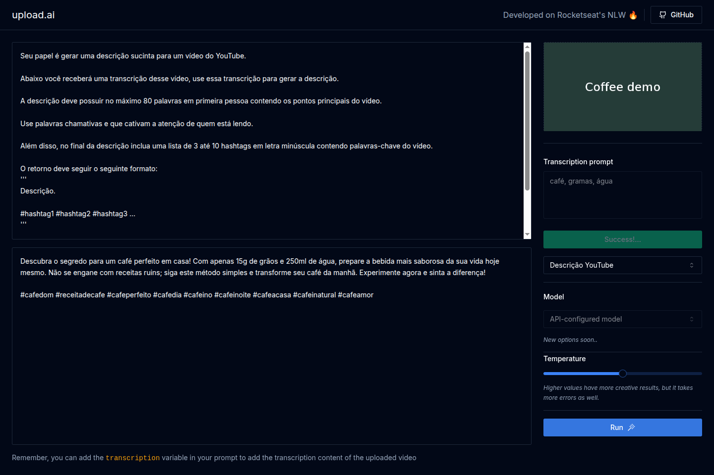

# Video Upload AI

Video Upload AI extracts audio from an MP4 in the browser, transcribes it through a Fastify API, and generates suggested YouTube titles or a description from the transcript.

## Demo: generate YouTube copy for a coffee video

The input was a 7-second MP4 with synthetic Brazilian Portuguese audio. In Chrome, FFmpeg converted it to `audio.mp3`, the API accepted the upload, and local Whisper and Qwen handled transcription and generation. [Download the sample MP4](docs/assets/coffee-demo.mp4)

The API returned `200 OK` for the upload, transcription, and both generation requests. Whisper returned “Para preparar o café, use 15 gramas de café e 250 ml de água.” The screenshots show the unedited output streamed into the UI.




I also tried the original hosted OpenAI path with a placeholder key. Browser-side extraction and `POST /videos` succeeded (`200 OK`). `POST /videos/:videoId/transcription` returned `401 Unauthorized` with `invalid_api_key`, and the UI displayed **Transcription failed (HTTP 401).** The hosted attempt stopped at transcription.

## Prerequisites

- Node.js 24 and pnpm 8 (verified with Node.js 24.11.0 and pnpm 8.15.9).
- A browser with WebAssembly support. The recorded run used Chrome.
- For local inference, install `whisper-server`, `llama-server`, and FFmpeg. Use multilingual Whisper Small and Qwen 3.5 4B Q4_K_M weights. [Whisper.cpp](https://github.com/ggml-org/whisper.cpp) · [Whisper Small weights](https://huggingface.co/ggerganov/whisper.cpp/blob/main/ggml-small.bin) · [llama.cpp](https://github.com/ggml-org/llama.cpp/releases) · [Qwen GGUF](https://huggingface.co/ggml-org/Qwen3.5-4B-GGUF)

## Environment variables

Create `upload-ai-backend/.env`. The frontend connects to `http://localhost:3333`.

| Variable | Purpose |
| --- | --- |
| `DATABASE_URL` | SQLite URL, relative to the Prisma schema for the setup below. |
| `OPENAI_API_KEY` | SDK key. Use the placeholder below with the unauthenticated loopback servers, or a valid key for hosted OpenAI. |
| `OPENAI_TRANSCRIPTION_BASE_URL`, `OPENAI_GENERATION_BASE_URL` | Optional OpenAI-compatible base URLs. When unset, the SDK uses hosted OpenAI. |
| `OPENAI_TRANSCRIPTION_MODEL`, `OPENAI_GENERATION_MODEL` | Model overrides. The original defaults are `whisper-1` and `gpt-3.5-turbo-16k`. For hosted use, set both to available models that support transcription or streamed Chat Completions. |

## Run locally

Start the two model servers in separate terminals. Replace the paths with your model files.

```bash
whisper-server --model /path/to/ggml-small.bin --host 127.0.0.1 --port 18083 \
  --inference-path /v1/audio/transcriptions --language pt --threads 4 --no-gpu --convert

llama-server -m /path/to/Qwen3.5-4B-Q4_K_M.gguf \
  --alias qwen3.5-4b --host 127.0.0.1 --port 18081 \
  --ctx-size 2048 --parallel 1 --threads 4 --n-gpu-layers 0 --reasoning off
```

Save this configuration in `upload-ai-backend/.env`.

```dotenv
DATABASE_URL=file:./demo.db
OPENAI_API_KEY=demo-placeholder
OPENAI_TRANSCRIPTION_BASE_URL=http://127.0.0.1:18083/v1
OPENAI_GENERATION_BASE_URL=http://127.0.0.1:18081/v1
OPENAI_GENERATION_MODEL=qwen3.5-4b
```

From the repository root, install the backend dependencies and initialize SQLite.

```bash
cd upload-ai-backend
pnpm install --frozen-lockfile
mkdir -p temp
pnpm exec prisma migrate deploy
```

If Prisma 5.2 reports an empty `Schema engine error`, apply the checked-in SQL directly to a fresh demo database. This was the fallback used for the recorded run.

```bash
python3 - <<'PY'
from pathlib import Path
import sqlite3

migration = Path("prisma/migrations/20230912235141_create_videos_and_prompt_tables/migration.sql")
with sqlite3.connect("prisma/demo.db") as database:
    database.executescript(migration.read_text())
PY
```

Generate the Prisma client, seed the prompt templates, and start the API.

```bash
pnpm exec prisma generate
pnpm exec prisma db seed
pnpm dev
```

In a second terminal from the repository root:

```bash
cd video-upload-ai-frontend
pnpm install --frozen-lockfile
pnpm dev --host 127.0.0.1
```

1. Open [the local frontend](http://127.0.0.1:5173) and select `docs/assets/coffee-demo.mp4`.
2. Enter `café, gramas, água` in **Transcription prompt**, click **Load Video**, and wait for **Success!**.
3. Select **Título YouTube** and click **Run**. Read the three suggestions in **AI result**.
4. Select **Descrição YouTube** and click **Run** again. Read the description and hashtags in the same output field.

## Attribution

Built during [Rocketseat's NLW](https://rocketseat.com.br). The demo recording uses a synthetic [Piper Brazilian Portuguese voice](https://huggingface.co/rhasspy/piper-voices/tree/main/pt/pt_BR/faber/medium).
