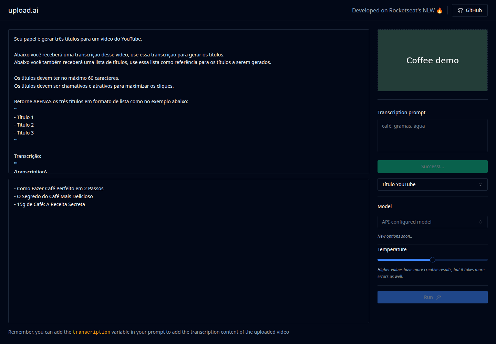

# Video Upload AI

Video Upload AI extracts audio from an MP4 in the browser, transcribes it through a Fastify API, and generates suggested YouTube titles or a description from the transcript.
Choose OpenAI, Gemini, or a local model server independently for transcription and text generation.

## Demo: generate YouTube copy for a coffee video

The input was a 7-second MP4 with synthetic Brazilian Portuguese audio. In Chrome, FFmpeg converted it to `audio.mp3`, the API accepted the upload, and local Whisper and Qwen handled transcription and generation. [Download the sample MP4](docs/assets/coffee-demo.mp4)

The API returned `200 OK` for the upload, transcription, and both generation requests. Whisper returned “Para preparar o café, use 15 gramas de café e 250 ml de água.” The screenshots show the unedited output streamed into the UI.




In an earlier run against hosted OpenAI with a placeholder key, browser-side extraction and `POST /videos` succeeded (`200 OK`). `POST /videos/:videoId/transcription` returned `401 Unauthorized` with `invalid_api_key`, and the UI displayed **Transcription failed (HTTP 401).** The hosted attempt stopped at transcription.

The provider tests exercise the hosted SDKs with simulated HTTP responses. The browser demo uses real local inference.

## Prerequisites

- Node.js 24 and pnpm 8 (verified with Node.js 24.11.0 and pnpm 8.15.9).
- A browser with WebAssembly support. The recorded run used Chrome.
- For local inference, install `whisper-server`, `llama-server`, and FFmpeg. Use multilingual Whisper Small and Qwen 3.5 4B Q4_K_M weights. [Whisper.cpp](https://github.com/ggml-org/whisper.cpp) · [Whisper Small weights](https://huggingface.co/ggerganov/whisper.cpp/blob/main/ggml-small.bin) · [llama.cpp](https://github.com/ggml-org/llama.cpp/releases) · [Qwen GGUF](https://huggingface.co/ggml-org/Qwen3.5-4B-GGUF)

## Environment variables

Copy `upload-ai-backend/.env.example` to `upload-ai-backend/.env`. The frontend connects to `http://localhost:3333`.

| Variable | Purpose |
| --- | --- |
| `DATABASE_URL` | SQLite URL, relative to the Prisma schema for the setup below. |
| `AI_PROVIDER` | Default provider for both operations. Accepts `local`, `openai`, or `gemini`. Defaults to `openai` when unset. The sample file selects `local`. |
| `AI_TRANSCRIPTION_PROVIDER`, `AI_GENERATION_PROVIDER` | Optional provider overrides for each operation. |
| `LOCAL_TRANSCRIPTION_BASE_URL`, `LOCAL_GENERATION_BASE_URL` | OpenAI-compatible base URLs. The defaults are `http://127.0.0.1:18083/v1` for Whisper and `http://127.0.0.1:18081/v1` for llama.cpp. |
| `LOCAL_TRANSCRIPTION_MODEL`, `LOCAL_GENERATION_MODEL` | Local model names. Default to `whisper-1` and `qwen3.5-4b`. |
| `LOCAL_TRANSCRIPTION_API_KEY`, `LOCAL_GENERATION_API_KEY` | Optional bearer credentials for the corresponding local endpoint. Leave both unset for the demo. |
| `OPENAI_API_KEY`, `OPENAI_ORG_ID` | Hosted OpenAI API key and optional organization ID. |
| `OPENAI_TRANSCRIPTION_MODEL`, `OPENAI_GENERATION_MODEL` | Hosted OpenAI models. Default to `gpt-transcribe` and `gpt-4.1-mini`. Generation requires a model that supports streamed Chat Completions and the temperature parameter. |
| `GEMINI_API_KEY` | Gemini Developer API key. |
| `GEMINI_TRANSCRIPTION_MODEL`, `GEMINI_GENERATION_MODEL` | Gemini models. Both default to `gemini-3.8-flash`. Transcription requires audio input support. |

Set `AI_PROVIDER=openai` or `AI_PROVIDER=gemini` and supply the corresponding key to run both operations against that service. To keep the audio on a local server and send the resulting transcript to Gemini for generation, set `AI_PROVIDER=gemini`, `AI_TRANSCRIPTION_PROVIDER=local`, and `GEMINI_API_KEY`. Only the selected providers require configuration.

The Gemini adapter sends audio inline. The API returns HTTP `413` when the encoded request would exceed 20 MB, including the prompt. [Gemini audio documentation](https://ai.google.dev/gemini-api/docs/audio)

If your `.env` contains `OPENAI_TRANSCRIPTION_BASE_URL` or `OPENAI_GENERATION_BASE_URL`, move those URLs to `LOCAL_TRANSCRIPTION_BASE_URL` or `LOCAL_GENERATION_BASE_URL` and select `local` for the affected operations. Move local model overrides to the corresponding `LOCAL_*_MODEL` variables and remove the old URL settings. The demo configuration needs no placeholder key.

## Run locally

Start the two model servers in separate terminals. Replace the paths with your model files.

```bash
whisper-server --model /path/to/ggml-small.bin --host 127.0.0.1 --port 18083 \
  --inference-path /v1/audio/transcriptions --language pt --threads 4 --no-gpu --convert

llama-server -m /path/to/Qwen3.5-4B-Q4_K_M.gguf \
  --alias qwen3.5-4b --host 127.0.0.1 --port 18081 \
  --ctx-size 2048 --parallel 1 --threads 4 --n-gpu-layers 0 --reasoning off
```

From the repository root, copy the example configuration. It selects the two loopback model servers above.

```bash
cp -n upload-ai-backend/.env.example upload-ai-backend/.env
```

From the repository root, install the backend dependencies and initialize SQLite.

```bash
cd upload-ai-backend
pnpm install --frozen-lockfile
mkdir -p temp
pnpm exec prisma migrate deploy
```

If Prisma 5.2 reports an empty `Schema engine error`, apply the checked-in SQL directly to a fresh demo database. This was the fallback used for the recorded run.

```bash
python3 - <<'PY'
from pathlib import Path
import sqlite3

migration = Path("prisma/migrations/20230912235141_create_videos_and_prompt_tables/migration.sql")
with sqlite3.connect("prisma/demo.db") as database:
    database.executescript(migration.read_text())
PY
```

Generate the Prisma client, seed the prompt templates, and start the API.

```bash
pnpm exec prisma generate
pnpm exec prisma db seed
pnpm dev
```

In a second terminal from the repository root:

```bash
cd video-upload-ai-frontend
pnpm install --frozen-lockfile
pnpm dev --host 127.0.0.1
```

1. Open [the local frontend](http://127.0.0.1:5173) and select `docs/assets/coffee-demo.mp4`.
2. Enter `café, gramas, água` in **Transcription prompt**, click **Load Video**, and wait for **Success!**.
3. Select **Título YouTube** and click **Run**. Read the three suggestions in **AI result**.
4. Select **Descrição YouTube** and click **Run** again. Read the description and hashtags in the same output field.

## Add a provider

1. Add a TypeScript file under [`upload-ai-backend/src/ai/providers`](upload-ai-backend/src/ai/providers). Use [`ProviderFactory`](upload-ai-backend/src/ai/provider.ts) and implement the operations your SDK supports. Transcription returns text from an uploaded audio file. Generation returns an async iterable of text chunks.
2. Read credentials for your SDK inside that adapter. Give it its own environment variable names.
3. Register the adapter in [`upload-ai-backend/src/ai/index.ts`](upload-ai-backend/src/ai/index.ts) and select its name in `.env`. The API routes use the shared transcription and generation contracts.

Run `pnpm test` from `upload-ai-backend` to check provider selection, request mapping, and credential isolation.

## Attribution

Built during [Rocketseat's NLW](https://rocketseat.com.br). The demo recording uses a synthetic [Piper Brazilian Portuguese voice](https://huggingface.co/rhasspy/piper-voices/tree/main/pt/pt_BR/faber/medium).
